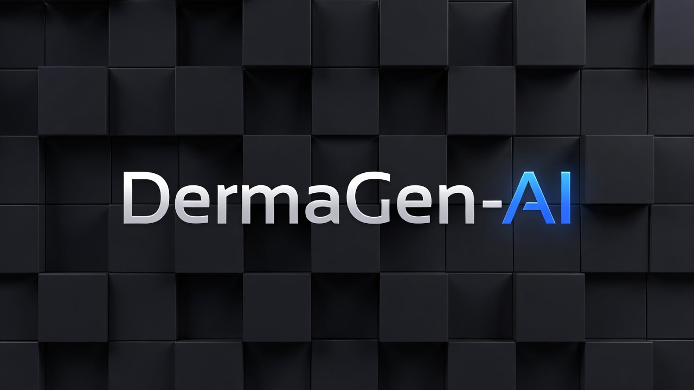

<div align="center">

</div>
<h1 style="font-size: 72px;">GMod Derma VGUI Editor</h1>

**DermaGen AI** is a powerful, modern web-based visual editor designed to streamline the creation of User Interfaces (Derma) for Garry's Mod. It combines a drag-and-drop WYSIWYG editor with advanced AI capabilities to generate production-ready Lua code instantly.

## 🚀 Features

- **Visual Interface Builder**: Intuitive drag-and-drop system to design complex UI layouts without writing a single line of code initially.
- **Component Library**: comprehensive support for standard GMod VGUI elements including:
  - `DFrame` (Windows)
  - `DPanel`
  - `DButton`
  - `DLabel`
  - `DCheckBox`
  - `DListView`
  - And more...
- **Real-time Lua Generation**: As you build, the editor instantly generates clean, readable, and functional Lua code ready to be pasted into your GMod project.
- **AI-Powered Layouts**: Integrated with **Google Gemini**, allowing you to generate entire UI structures simply by describing them (e.g., "Create a dark-themed login menu with username and password fields").
- **Property Inspector**: Fine-tune every aspect of your components, from position and size to colors and custom variables.
- **Event & Method System**: Define custom behaviors and methods for your controls directly within the editor.
- **Project Management**:
  - Save/Load projects (`.json`)
  - Export to `.lua`
  - **Import Lua**: Experimental support for parsing existing Derma code back into the editor.
- **Developer Experience**:
  - Undo/Redo history
  - Grid snapping
  - Resizable panels
  - Dark mode interface optimized for long coding sessions

## 🛠️ Tech Stack

- **Framework**: React 19 (TypeScript)
- **Build Tool**: Vite
- **Styling**: Tailwind CSS v4
- **AI Integration**: Google GenAI SDK
- **Icons**: Lucide React

## 📦 Installation & Setup

### Prerequisites
- Node.js (v18 or higher recommended)
- npm or yarn

### Steps

1.  **Clone the repository:**
    ```bash
    git clone https://github.com/yourusername/dermagen-ai.git
    cd dermagen-ai
    ```

2.  **Install dependencies:**
    ```bash
    npm install
    ```

3.  **Configure Environment Variables:**
    Create a `.env.local` file in the root directory and add your Google Gemini API key to enable AI features:
    ```env
    GEMINI_API_KEY=your_api_key_here
    ```

4.  **Run Development Server:**
    ```bash
    npm run dev
    ```
    The application will be available at `http://localhost:3000`.

### Docker Deployment

The project includes a Docker setup for easy deployment.

1.  **Build and Run**:
    ```bash
    # Ensure your .env.local file exists with the API key
    docker-compose --env-file .env.local up --build
    ```

2.  **Access the App**:
    Open your browser to `http://localhost:8080`.

## 📖 Usage Guide

### Getting Started
1.  **Create a Root Frame**: Start by adding a `DFrame` from the sidebar. This acts as the main window for your UI.
2.  **Add Components**: Drag components (Buttons, Labels, etc.) onto the frame or use the sidebar to append them.
3.  **Select & Edit**: Click any element on the canvas to view and modify its properties in the right-hand panel.
4.  **View Code**: The bottom panel displays the live Lua code. You can copy this at any time.

### Using AI Generation
1.  Click the "Generate with AI" button in the top toolbar.
2.  Enter a descriptive prompt (e.g., "A modern HUD with health and armor bars at the bottom left").
3.  Wait for the AI to generate the layout structure.

## 🤝 Contributing

Contributions are welcome! Please feel free to submit a Pull Request.

1.  Fork the project
2.  Create your feature branch (`git checkout -b feature/AmazingFeature`)
3.  Commit your changes (`git commit -m 'Add some AmazingFeature'`)
4.  Push to the branch (`git push origin feature/AmazingFeature`)
5.  Open a Pull Request

## 📄 License

This project is licensed under the MIT License - see the [LICENSE](LICENSE) file for details.
